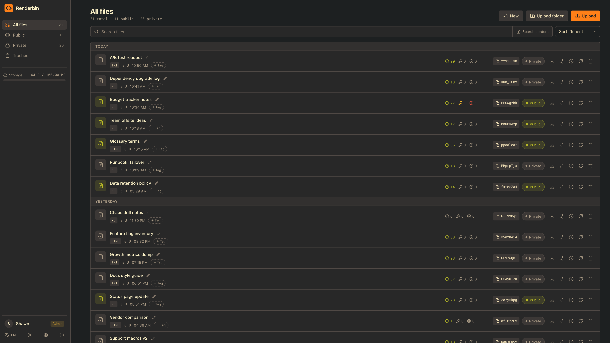

# Renderbin

**中文** | [English](#renderbin-english)

一个自托管的文件分享服务:上传 HTML、Markdown 或文本文件(也可以是带 `index.html` 的整个目录),得到一个链接,打开就是渲染好的页面。适合分享 AI 编程助手产出的那些自包含报告页——配合内置的 **MCP 服务**,Agent 可以自己上传,在同一轮对话里把链接交给你。

支持多用户(首个账号即超级管理员,注册可开关),文件可设为公开(链接带随机访问码)或私有,可按时间或访问次数过期,有标签、搜索、回收站、每账号存储配额和一键备份恢复,界面中英双语。整个服务是**一个自包含的二进制/容器**,所有状态都在一个 SQLite 文件里。



## 快速开始

```bash
curl -O https://raw.githubusercontent.com/shawn-bluce/renderbin/master/docker-compose.yml
docker compose up -d
```

容器只监听 `127.0.0.1:8080`,用 Nginx 或 Caddy 把域名反向代理过去,并转发 `X-Forwarded-Proto`(若代理改写了来源,还需 `X-Forwarded-Host`)。打开站点,在欢迎页创建第一个账号——它即超级管理员,注册和 MCP 的开关也在那里选。没有凭据类环境变量,账号存在数据库里。

数据都在 `db-data` 卷中,升级只需 `docker compose pull && docker compose up -d`(`down -v` 会删库)。不想用 Docker 的话,每个 release 都附带无依赖的静态 Linux 二进制:

```bash
curl -LO https://github.com/shawn-bluce/renderbin/releases/latest/download/renderbin_linux_amd64.tar.gz
tar xzf renderbin_linux_amd64.tar.gz && ./renderbin
```

环境变量只有两个,其余配置都在应用的设置页里:

| 变量          | 默认值        | 说明                  |
| ------------- | ------------- | --------------------- |
| `LISTEN_ADDR` | `:8080`       | 服务监听地址          |
| `DB_PATH`     | `data/app.db` | SQLite 数据库文件路径 |

## 多页面站点

除了单个文件，也可以上传**一个目录**：顶层有 `index.html`，再加上它用到的其他页面、CSS、JS、JSON 等。目录里的文件用**相对路径**互相引用和跳转（`css/style.css`、`docs/`、`../index.html`）都能正常工作，HTML 一个字都不用改。

- 在面板上点 **上传文件夹**，或者把文件夹（或 `.zip`）拖进页面；`.zip` 也可以直接用 **上传** 按钮选。
- 分享链接的格式不变（`/res/{slug}?code=...`），打开后会跳到 `/res/{slug}/{访问码}/`，相对路径靠的就是这一段。主人打开私有站点时用的是一个 6 小时有效的预览链接。
- 访问次数上限（`max_views`）按 **HTML 页面浏览次数**计：样式、脚本、数据文件不计数，但在站内每打开一个页面都算一次。
- 上限：解压后 5 MB、200 个文件、单个路径 255 字节；上传的 zip 本身不超过 8 MB。配额按压缩后的大小计。
- 不支持以 `/` 开头的根绝对路径（`/style.css` 会指向本站根目录），路径区分大小写。站点和单文件一样运行在沙箱里，所以 `localStorage`、Service Worker 等不可用。
- 站点里的单个文件不能在线编辑，只能在编辑弹窗里整包替换（或通过 MCP 的 `update_site` 按文件修改）。

有 shell 的 Agent 可以直接用 API Key 调 REST 上传，内容不经过模型：

```sh
cd my-site && zip -r ../site.zip . && cd ..
curl --data-binary @site.zip \
  -H "Content-Type: application/zip" \
  -H "Authorization: Bearer rb_..." \
  "https://your-host/api/sites?name=My%20Site"
```

整包替换已有站点用 `PUT /api/files/{slug}/site`，请求体同样是 zip。

## MCP

在**设置 → AI 能力**中启用 MCP 即可获得每用户的 API Key,然后让客户端以该 Key 作为 Bearer Token 连接 `/mcp`:

```bash
claude mcp add --transport http renderbin https://your-host/mcp \
  --header "Authorization: Bearer rb_..."
```

工具全部只作用于 Key 属主自己的文件:`upload_file`、`upload_files`(最多 20 个)、`list_files`、`search_files`、`update_file`、`publish_file`(可附带 `ttl` 或 `max_views` 限制)、`unpublish_file`、`delete_file`(两段式确认,仅移入回收站),以及多页面站点的 `upload_site`(按路径传文本文件,服务端打包)和 `update_site`(只传改动的文件,未提及的文件保持不变)。

同一个 Key 也可以作为 Bearer Token 直接调用 REST API(如 `curl -H "Authorization: Bearer rb_..." https://your-host/api/files`),规则与 MCP 一致:随 MCP 开关一同生效、账号停用即失效,且始终只是文件级凭据——备份、账号管理等超管接口仍要求浏览器登录的会话。

## 技术栈

一个进程、一个数据库文件,不依赖任何外部服务:

- 后端 **Go**:[chi](https://github.com/go-chi/chi) 路由、[modernc.org/sqlite](https://pkg.go.dev/modernc.org/sqlite)(纯 Go 驱动)、[sqlc](https://sqlc.dev/)、[goldmark](https://github.com/yuin/goldmark) 渲染 Markdown、官方 [MCP Go SDK](https://github.com/modelcontextprotocol/go-sdk)
- 前端 **[SvelteKit 2](https://svelte.dev/docs/kit) + [Svelte 5](https://svelte.dev/)** 纯 SPA,[Tailwind v4](https://tailwindcss.com/),构建产物通过 `//go:embed` 嵌进二进制——生产环境没有 Node 进程
- 文件内容以文本存在 SQLite 中,从不落盘;会话和数据库迁移也都在库里,迁移在启动时自动应用

## 安全须知

- 上传的 HTML/Markdown **不做净化、带脚本原样输出**——这正是工具的意义——但每个文档都在 `Content-Security-Policy: sandbox` 的独立源中运行:脚本照常工作,却读不到访问者的 Cookie,也无法以其身份调用本站 API。想要更强隔离,可把 `/res` 放到单独的域名下。
- 账号之间的文件在 SQL 层按属主隔离,超级管理员也看不到别人的文件内容——只多了全局设置、数据库备份和账号管理。
- 上传有上限:单文件 5 MB,多页面站点解压后 5 MB / 200 个文件,每账号默认 100 MB 存储配额(超级管理员可调)。
- 没有自助找回密码:普通账号请超级管理员在设置页重置;超级管理员自己忘了密码,用 `docker compose exec app ./server reset-password --user=NAME`。
- 发现漏洞请开 issue 说明**影响面**,修复发布前先不要贴出可直接利用的细节。

## 本地开发

```bash
make dev-api   # Go 服务,:8080
make dev-web   # Vite 开发服务器,:5173(代理 /api、/res 和 /mcp,无需配置 CORS)
```

另有 `make build`、`make test`、`make check`、`make sqlc`——详见 [`Makefile`](Makefile)。迁移只向前:在 `backend/internal/db/migrations/` 下新增编号文件,绝不修改已应用的迁移;改动任何查询后运行 `make sqlc`。提 PR 前请保证 `make check` 和 `make test` 通过。

## 许可证

[MIT](LICENSE)。

---

# Renderbin (English)

[中文](#renderbin) | **English**

A self-hosted file-sharing service: upload an HTML, Markdown, or text file (or a whole directory with an `index.html`) and get a link that opens as a rendered page. Built for the self-contained report pages AI coding agents keep producing — with the built-in **MCP server**, the agent uploads the file itself and hands you the link in the same turn.

Multi-user (the first account is the super admin, registration is toggleable), files are public (links carry a random access code) or private, links can expire by time or view count, with tags, search, a trash bin, per-account storage quotas, one-click backup/restore, and a bilingual UI. The whole service ships as **one self-contained binary/container** with all state in a single SQLite file.


## Quick start

```bash
curl -O https://raw.githubusercontent.com/shawn-bluce/renderbin/master/docker-compose.yml
docker compose up -d
```

The container listens on `127.0.0.1:8080` only; reverse-proxy a domain to it with Nginx or Caddy, forwarding `X-Forwarded-Proto` (and `X-Forwarded-Host` if the proxy rewrites the origin). Open the site and create the first account on the welcome page — it becomes the super admin, and the registration and MCP toggles are chosen there. There are no credential env vars; accounts live in the database.

All state lives in the `db-data` volume; upgrade with `docker compose pull && docker compose up -d` (`down -v` deletes the database). Prefer no Docker? Every release attaches static, dependency-free Linux binaries:

```bash
curl -LO https://github.com/shawn-bluce/renderbin/releases/latest/download/renderbin_linux_amd64.tar.gz
tar xzf renderbin_linux_amd64.tar.gz && ./renderbin
```

There are only two environment variables; everything else is configured in the app's Settings page:

| Variable      | Default       | Description                      |
| ------------- | ------------- | -------------------------------- |
| `LISTEN_ADDR` | `:8080`       | Address the server binds to      |
| `DB_PATH`     | `data/app.db` | Path to the SQLite database file |

## Multi-page sites

Besides single files you can upload **a directory**: an `index.html` at its top plus the other pages, CSS, JS, JSON and so on it uses. Files in it can load and link to each other with **relative paths** (`css/style.css`, `docs/`, `../index.html`) and it all just works, without changing a byte of the HTML.

- Click **Upload folder** on the dashboard, or drag a folder (or a `.zip`) onto the page; a `.zip` can also be picked with the ordinary **Upload** button.
- The share link format is unchanged (`/res/{slug}?code=...`). Opening it redirects to `/res/{slug}/{access-code}/`, which is the path segment every relative reference carries along. The owner opens a private site through a preview link that is valid for 6 hours.
- A view limit (`max_views`) counts **HTML page views**: stylesheets, scripts and data files are free, but every page opened inside the site counts once.
- Limits: 5 MB uncompressed, 200 files, 255-byte paths; the uploaded zip itself at most 8 MB. The quota counts the compressed size.
- Root-absolute paths (`/style.css`) are not supported — they point at this app's root — and paths are case-sensitive. A site runs in the same sandbox as a single file, so `localStorage`, Service Workers and the like are unavailable.
- Single files inside a site cannot be edited in the browser; replace the whole site from the edit dialog (or patch individual files with the MCP `update_site` tool).

An agent with a shell can upload straight to the REST API with the API key, without the content passing through the model:

```sh
cd my-site && zip -r ../site.zip . && cd ..
curl --data-binary @site.zip \
  -H "Content-Type: application/zip" \
  -H "Authorization: Bearer rb_..." \
  "https://your-host/api/sites?name=My%20Site"
```

To replace an existing site's content, `PUT /api/files/{slug}/site` with a zip body.

## MCP

Enable MCP in **Settings → AI capability** to get a per-user API key, then point your client at `/mcp` with that key as a Bearer token:

```bash
claude mcp add --transport http renderbin https://your-host/mcp \
  --header "Authorization: Bearer rb_..."
```

Tools, all scoped to the key owner's own files: `upload_file`, `upload_files` (up to 20), `list_files`, `search_files`, `update_file`, `publish_file` (optionally with a `ttl` or `max_views` limit), `unpublish_file`, `delete_file` (two-step confirm, trash only), plus `upload_site` (text files by path, packed server-side) and `update_site` (send only what changed; files you do not mention stay as they are) for multi-page sites.

The same key also works as a Bearer token against the REST API (e.g. `curl -H "Authorization: Bearer rb_..." https://your-host/api/files`), under the same rules as MCP: it lives and dies with the MCP toggle and the account's status, and it stays a file-scope credential — super-admin endpoints (backup, account management) still require a browser-login session.

## Tech stack

One process, one database file, no external services:

- Backend in **Go**: [chi](https://github.com/go-chi/chi) for routing, [modernc.org/sqlite](https://pkg.go.dev/modernc.org/sqlite) (pure-Go driver), [sqlc](https://sqlc.dev/), [goldmark](https://github.com/yuin/goldmark) for Markdown, the official [MCP Go SDK](https://github.com/modelcontextprotocol/go-sdk)
- Frontend as a pure **[SvelteKit 2](https://svelte.dev/docs/kit) + [Svelte 5](https://svelte.dev/)** SPA with [Tailwind v4](https://tailwindcss.com/), embedded into the binary via `//go:embed` — no Node in production
- File contents are stored as text in SQLite and never touch the filesystem; sessions and database migrations live in the DB too, with migrations applying themselves on start

## Security notes

- Uploaded HTML/Markdown is served **unsanitized, scripts intact** — that's the point of the tool — but every document runs in its own origin under `Content-Security-Policy: sandbox`: scripts work, yet the page cannot read the viewer's cookies or call this app's API as them. For stronger separation, serve `/res` from a different hostname.
- Files are isolated per account in SQL; even the super admin cannot see other users' file contents — id=1 only gains the global settings, the database backup, and account management.
- Uploads are bounded: 5 MB per file, 5 MB / 200 files per multi-page site, and each account has a storage quota (100 MB by default, adjustable by the super admin).
- There is no self-service password reset: ask the super admin to reset yours in Settings; if the super admin is locked out, use `docker compose exec app ./server reset-password --user=NAME`.
- Found a vulnerability? Open an issue describing the **impact**, and hold back trivially exploitable details until a fix ships.

## Development

```bash
make dev-api   # Go server on :8080
make dev-web   # Vite dev server on :5173 (proxies /api, /res and /mcp, so no CORS setup)
```

Also `make build`, `make test`, `make check`, `make sqlc` — see the [`Makefile`](Makefile). Migrations are forward-only: add a new numbered file under `backend/internal/db/migrations/`, never edit an applied one, and run `make sqlc` after changing any query. Keep `make check` and `make test` green in a PR.

## License

[MIT](LICENSE).
